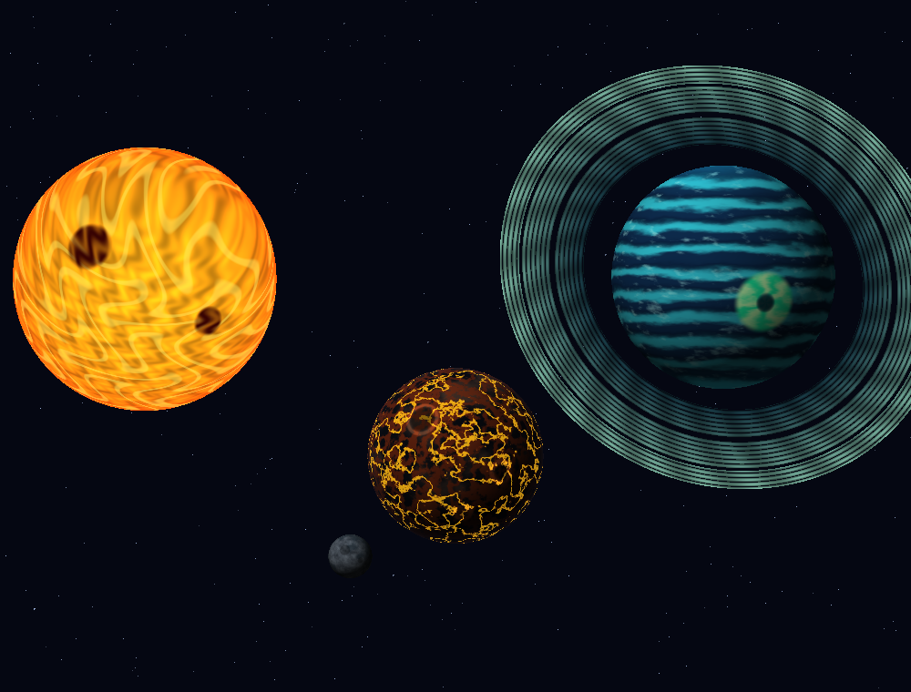
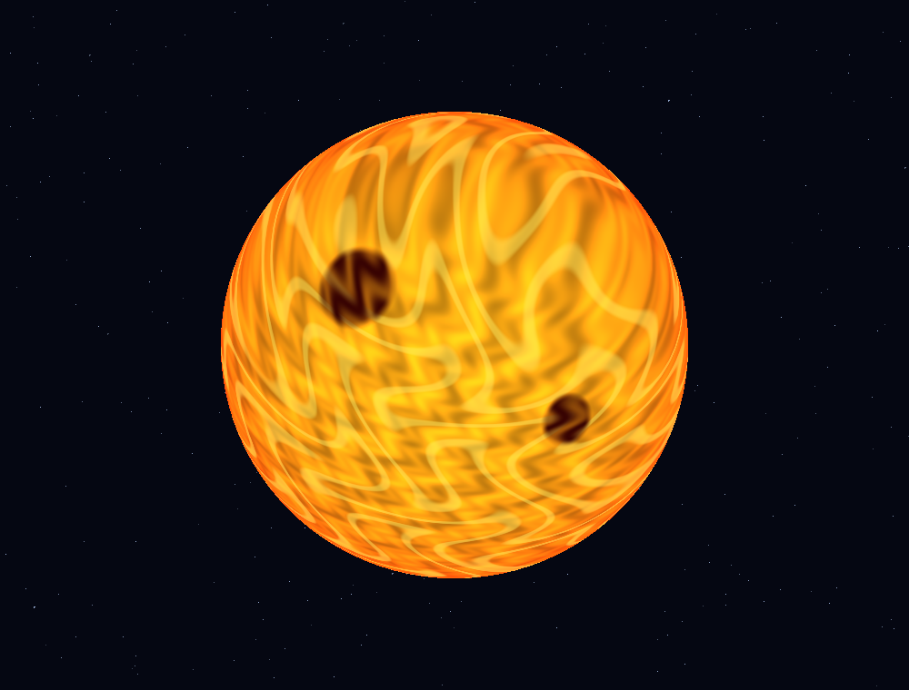
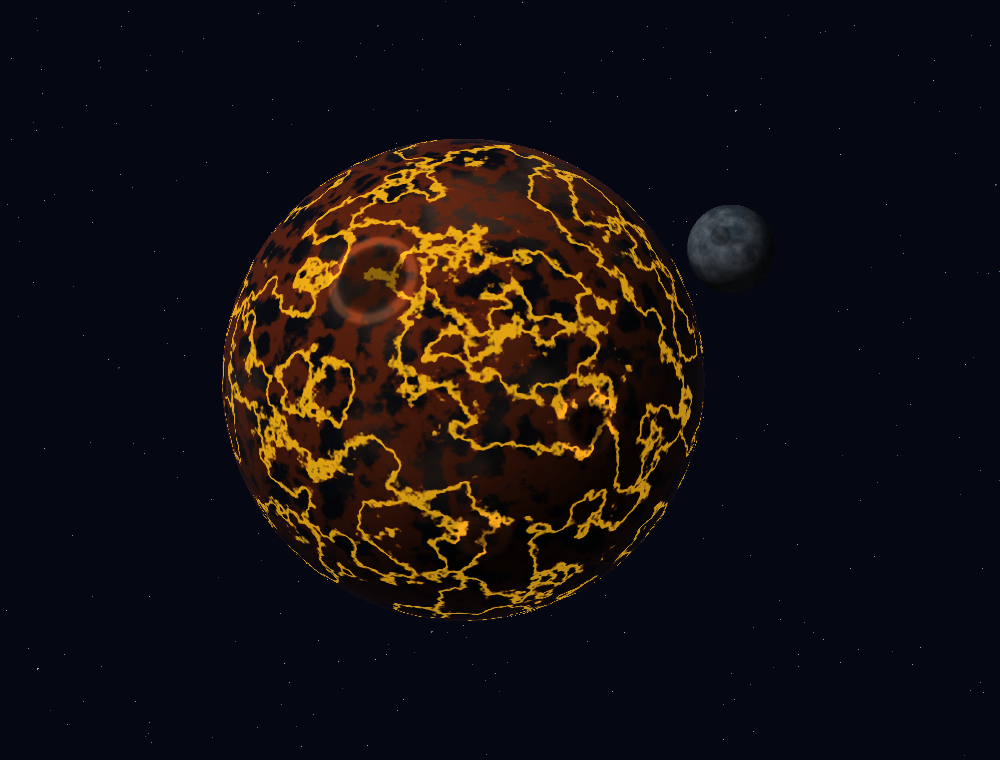
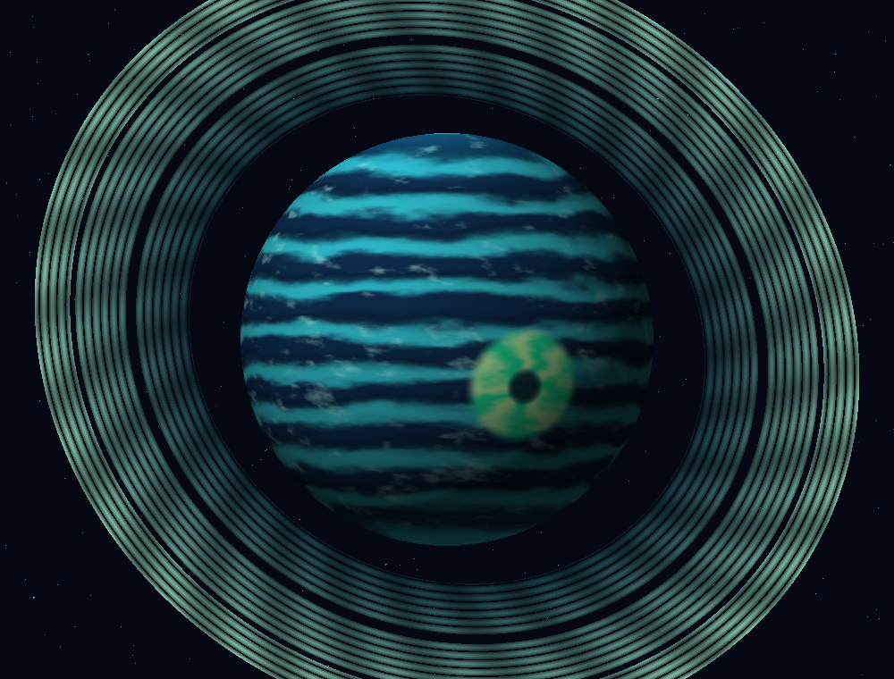

# Lab 5 — Sistema Ignis

**Antony Saz — 24710**

Software renderer en C++ que rasteriza un sistema solar enteramente procedural.
No se usan texturas, mapas de bits ni materiales: todos los colores nacen de
shaders ejecutados por fragmento con posición, normal y UV interpoladas.



## Cuerpos celestes

### Ignis — estrella de plasma



Combina cinco capas: gradiente térmico, granulación fractal, filamentos de
plasma, manchas solares con borde irregular y corona en el limbo.

### Cinder — planeta rocoso y su luna



Combina basalto procedural, vetas minerales, grietas de lava emisiva, cráteres
geométricos e iluminación direccional. Su luna es una segunda esfera con su
propio shader de altiplanos, mares y cráteres.

### Aurelia — gigante gaseoso con anillos



Combina bandas por latitud, cinturones oscuros, nubes turbulentas, una tormenta
esmeralda con ojo, auroras polares e iluminación. Los anillos son una malla
separada y su shader crea bandas, divisiones transparentes y radios sin textura.

## Compilar y ejecutar

Se necesita CMake 3.20 o posterior, Git y un compilador de C++17. CMake descarga
SDL2 y GLM automáticamente durante la primera configuración.

```powershell
cmake -S . -B build
cmake --build build --config Release
.\build\Release\lab5.exe
```

Controles:

- `1`: Ignis aislada.
- `2`: Cinder y su luna.
- `3`: Aurelia y sus anillos.
- `4`: sistema completo.
- `Espacio`: cambiar a la siguiente vista.
- `←` / `→`: rotar los cuerpos para inspeccionar el shader.
- `S`: guardar la vista actual en `captura_actual.png`.
- `Esc`: cerrar.

Las cuatro imágenes del README se regeneran sin abrir una ventana con:

```powershell
.\build\Release\lab5.exe --screenshots
```

También se puede exportar únicamente una vista (`1` a `4`):

```powershell
.\build\Release\lab5.exe --screenshot 3
```

## Estructura

- `src/shaders.cpp`: cinco shaders procedurales y funciones de ruido fractal.
- `src/mesh.cpp`: generación de la esfera UV y de la malla de anillos.
- `src/triangle.cpp`: rasterización baricéntrica e interpolación por fragmento.
- `src/framebuffer.cpp`: framebuffer, z-buffer y exportador PNG propio.
- `src/main.cpp`: escenas, transformaciones, controles y capturas.

